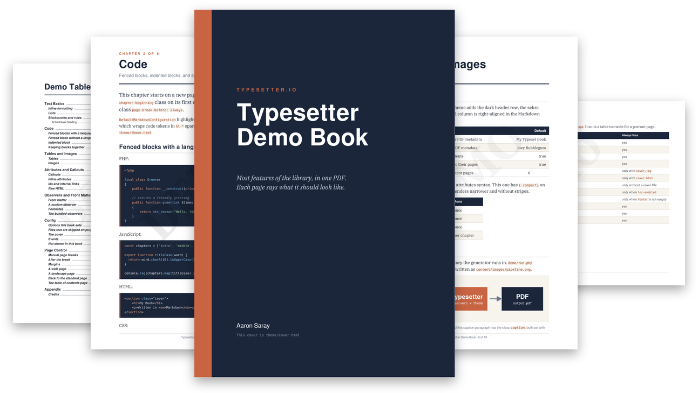

    

    
    
    

    

# Typesetter

Create ebooks, flyers, one-sheets and more from markdown! This command runs locally using PHP to convert your markdown into a PDF.

## Install

This requires PHP 8.4 or above.

This tool is meant to be part of the repository that you have your written content.  Because of that, you can install it into the local directory
with the following command.

`composer require typesetterio/typesetter-cli`

## Usage

Start a new project in the current directory:

`vendor/bin/typesetter init`

This writes `config.php`, a two chapter starter book in `content/` and `my-theme/theme.html`.

Generate the PDF:

`vendor/bin/typesetter generate`

| Option | Default | |
|---|---|---|
| `--config` | `config.php` | The config file. |
| `--output` | Slug of the title plus `.pdf` | The PDF file to write. |

Both paths are relative to the working directory.

### Docker

`docker run --rm -v "$PWD":/runtime ghcr.io/typesetterio/typesetter-cli generate`

The container runs as uid 1000. On Linux, to use a different user: `--user "$(id -u):$(id -g)"`.

To learn more, please check out the [documentation](https://typesetter.io). This details configuration, customization, themes and cover generation, observers, listeners and more.

## Development

Requires PHP 8.4 or newer and Composer. `make act` additionally needs Docker and [act](https://nektosact.com). On macOS, `brew install php composer act`.

Run `make` to list the available targets.

`docker build -t typesetter-cli .` builds the Docker image.

## Changelog

See [CHANGELOG.md](CHANGELOG.md).

## Credits

This was heavily influenced by the [Ibis](https://github.com/themsaid/ibis) project but is a complete rewrite.

This package stands on the shoulders of giants like [MPDF](https://mpdf.github.io/), some parts of [Laravel](https://laravel.com) and also the [League Commonmark](https://commonmark.thephpleague.com/) library.

[Aaron Saray](https://aaronsaray.com) is the primary author and maintainer.
